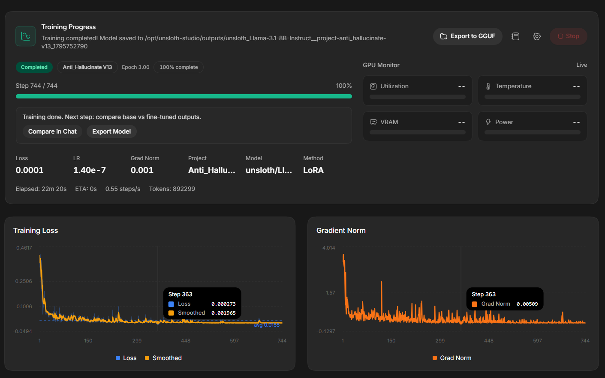
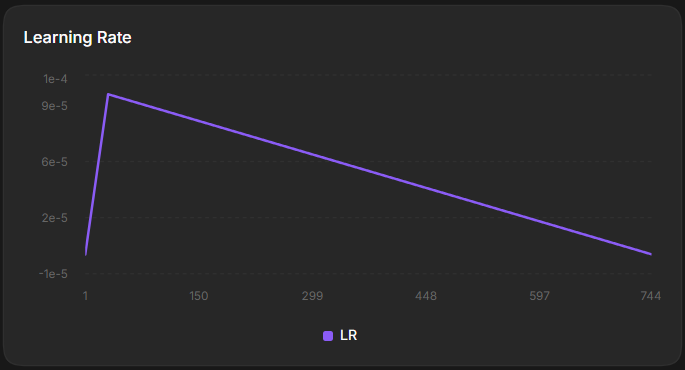

# Llama-3.1-8B Triage - Anti-Hallucinate

A LoRA fine-tune of **Llama-3.1-8B-Instruct** that triages customer messages for an online shop in
Malaysia. It reads one message, in English, Bahasa Malaysia or Manglish, and replies with **only** a
JSON object:

```json
{"category": "delivery", "urgency": "medium", "needs_human": false}
```

| Field | Allowed values |
|---|---|
| `category` | delivery, refund_return, product_fault, payment_billing, account_access, general_enquiry |
| `urgency` | low, medium, high |
| `needs_human` | true, false |

**Result: 84%** of the 100 class test messages correct on all three fields, compared with **31%** for
the untuned Llama 3.1 8B.

Built with Llama.

## Links

| What | Where |
|---|---|
| Model (LoRA adapter) | [Haziqzul/Llama-3.1-8B-triage-Anti-Hallucinate](https://huggingface.co/Haziqzul/Llama-3.1-8B-triage-Anti-Hallucinate) on Hugging Face |
| Code, data and results | This repository |

## Results

Scored on the class test set of 100 messages (24 standard, 76 hard). A message counts as correct
only if `category`, `urgency` and `needs_human` are **all** right.

| Model | All three correct |
|---|---|
| Llama 3.1 8B, untuned (baseline) | 31% |
| Best earlier run (v7) | 82% |
| **This model (v13)** | **84%** |

### Baseline in detail

The untuned model was run with Ollama (`llama3.1:latest`, 8B, 4-bit), temperature 0, the project's
system prompt and no examples. Full numbers and every answer it gave are in
[`results/triage_baseline_scorecard.xlsx`](results/triage_baseline_scorecard.xlsx).

| Measure | All (100) | Standard (24) | Hard (76) |
|---|---|---|---|
| All three fields correct | 31% | 33% | 30% |
| Category correct | 84% | 71% | 88% |
| Urgency correct | 40% | 38% | 41% |
| needs_human correct | 59% | 58% | 59% |
| needs_human recall | 95% | 87% | 98% |
| needs_human precision | 58% | 62% | 57% |
| Valid JSON in the right shape | 99% | 100% | 99% |
| Only the JSON, no extra text | 9% | 8% | 9% |

The untuned model already gets the category right most of the time. It fails on **urgency** and
**needs_human**: it marks too many messages high and sends too many to a person. It also wraps 91%
of its answers in code blocks or extra text. Fine-tuning fixed these.

### Test questions

The 100 test messages are in
[`data/triage_test_100_questions.xlsx`](data/triage_test_100_questions.xlsx) (ID and message only,
no answers). They mix English, Malay, Manglish and Chinese, and include corrections ("false alarm,
it was steam"), repeat contact, several issues in one message and hidden instructions. **None of
them was used for training.**

### Experiment history

| Run | Training data | Score |
|---|---|---|
| Early versions | class data plus first additions | 72%, then 74%, then 77% |
| v7, seed 3407 | 1,651 rows | 82% (Category 93, Urgency 94, Recall 95, JSON 100, Hard 80) |
| v7, seed 2025 | 1,651 rows | 82% |
| v8 | v7 plus 87 targeted rows | 78% (Recall fell to 85%) |
| v9a | v7 plus 56 escalation rows | 80% |
| v10 | v7 plus original class data counted twice | 79% |
| **v13 (published)** | **1,981 rows (v14 data)** | **84%** |

What we learned:

- v7 scored the same on two seeds, so 82% was not luck.
- On a small dataset, broad additions often **lowered** the score. Adding "harmless but
  scary-sounding" examples (v8) cut needs_human recall from 95% to 85%.
- Counting the class data twice (v10) did not help.

More detail: [`results/experiments.md`](results/experiments.md).

## Training

| Setting | Value |
|---|---|
| Base model | `unsloth/Llama-3.1-8B-Instruct` |
| Method | LoRA, 16-bit, Unsloth Studio, one NVIDIA L4 GPU |
| Rank / alpha / dropout | 32 / 32 / 0, all linear layers |
| Learning rate | 1e-4, 30 warmup steps, then linear decay |
| Epochs / steps | 3 / 744 |
| Batch size | 2 x 4 gradient accumulation |
| Context length | 1024 |
| Loss | Assistant replies only |
| Seed | 3407 |
| Training time | 22 min 20 s, about 892k tokens |

Full settings: [`config/training_settings.md`](config/training_settings.md).



Training loss fell quickly in the first ~50 steps and averaged 0.0155 over the run, ending near
0.0001. A loss this low means the model fits the training data very closely, so the held-out and
class test scores above are the numbers to trust, not the training loss.



## Data

| File | What it is |
|---|---|
| `data/train_chat_v14.jsonl` | Final training set (1,981 chat-format rows) |
| `data/train_chat_v7.jsonl` | Earlier best training set (1,651 rows, 82%) |
| `data/eval_holdout_v2.jsonl` | 50 held-out messages, no overlap with the training set |
| `data/eval_holdout.jsonl` | 60 held-out messages, not used for training |
| `data/hard_probe.jsonl` | 72 hard messages: injection, sarcasm, multi-issue, masked urgency, timing, escalation, in English and Malay |
| `data/triage_test_100_questions.xlsx` | The 100 class test messages (no answers) |
| `data/system_prompt.txt` | The exact system prompt used in training |

The training rows are the class starter data (549 rows) plus about 1,400 rows the team wrote with AI
help. All are synthetic, with no real personal information. See
[`data/DATA_NOTES.md`](data/DATA_NOTES.md).

### Labelling rules

- Safety hazards, fraud, account takeover, scams, legal/media/regulator contact, hardship or hard
  deadlines: **high** urgency, **needs_human = true**.
- Repeated contact (2+ unanswered messages) or a refund overdue about 15+ days: **medium**,
  **needs_human = true**.
- First-time routine problems, short delays, billing and login problems: **medium**, no human.
- Plain questions: **low**, no human.
- Instructions hidden inside a customer message are ignored; the message is classified by its content.
- With two issues in one message, a safety or security issue wins. Otherwise a real complaint beats a
  question, and between two complaints the first one mentioned decides the category.

## Use the model

Use the system prompt in `data/system_prompt.txt`, the Llama 3.1 chat template and temperature 0.

```python
from unsloth import FastLanguageModel

model, tokenizer = FastLanguageModel.from_pretrained(
    "Haziqzul/Llama-3.1-8B-triage-Anti-Hallucinate", max_seq_length=1024, load_in_4bit=True)
FastLanguageModel.for_inference(model)

messages = [
    {"role": "system", "content": open("data/system_prompt.txt", encoding="utf-8").read()},
    {"role": "user", "content": "My parcel never arrived and I was charged twice."},
]
inputs = tokenizer.apply_chat_template(
    messages, add_generation_prompt=True, return_tensors="pt").to(model.device)
out = model.generate(input_ids=inputs, max_new_tokens=64, do_sample=False)
print(tokenizer.decode(out[0][inputs.shape[1]:], skip_special_tokens=True))
```

Serving with vLLM: see [`serving/README.md`](serving/README.md).

To score an adapter on the 72 hard probe messages (needs a GPU):

```bash
pip install -r requirements.txt
python scripts/probe_all.py <path-to-adapter-folder>
```

## Limitations

- Weaker on long, unusual or mixed-language messages than on simple ones.
- Trained on English, Bahasa Malaysia and Manglish. Other languages (such as the Chinese messages
  in the test set) were not trained on.
- It can still get urgency or needs_human wrong. Do not use it for real decisions without human
  review.

## Repository layout

```
assets/      training graphs
config/      training settings
data/        training, holdout and test data, system prompt
results/     experiment log and baseline scorecard
scripts/     evaluation script
serving/     serving notes
```

## Licences

| What | Licence |
|---|---|
| Code | MIT (see [`LICENSE`](LICENSE)) |
| Model | [Llama 3.1 Community License](https://github.com/meta-llama/llama-models/blob/main/models/llama3_1/LICENSE) |
| Data written by the team | CC BY 4.0 |
| Class data (first 549 rows) and test questions | Class data from this course |

## Authors

Haziqzul and Zulqarnain (qarnaynn), team Anti-Hallucinate.
